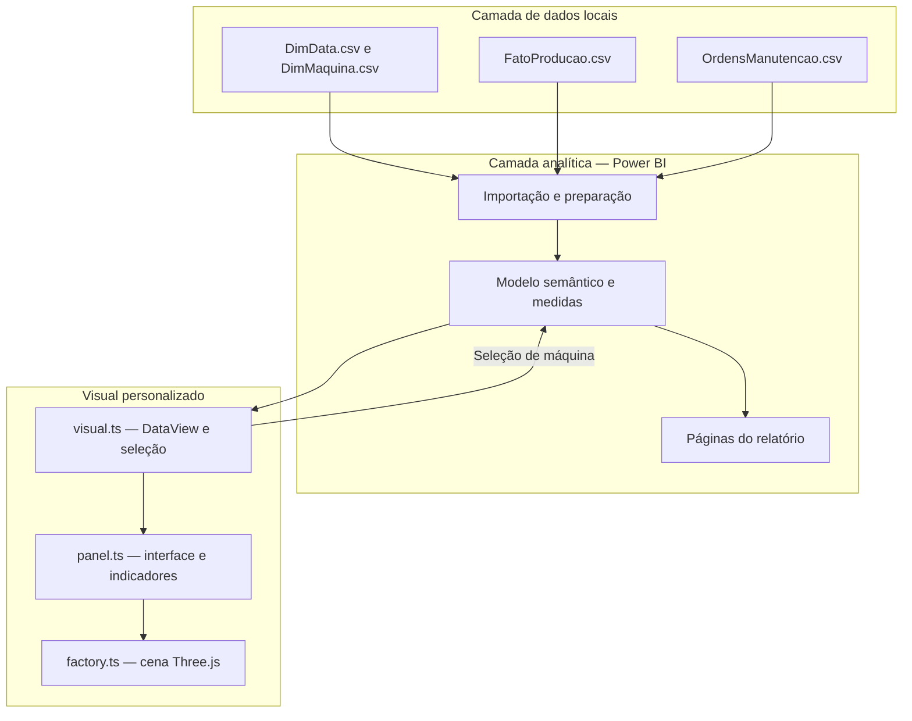

# Operação Industrial no Power BI com Fábrica 3D Interativa

**Inteligência de negócios aplicada à produção e à manutenção industrial, com visual personalizado desenvolvido em TypeScript e Three.js.**

**Autor:** Paulo Beni da Silva Filho  
**Natureza:** projeto de portfólio e demonstração técnica  
**Tecnologias principais:** Power BI, TypeScript, Three.js, Node.js e arquivos CSV.

> A animação representa visualmente uma linha industrial. O deslocamento dos veículos não corresponde à quantidade produzida e não caracteriza monitoramento em tempo real ou um gêmeo digital conectado a equipamentos.

## Sumário

- [1. Objetivo e problema de negócio](#1-objetivo-e-problema-de-negócio)
- [2. Aplicações práticas](#2-aplicações-práticas)
- [3. Escopo entregue](#3-escopo-entregue)
- [4. Arquitetura da solução](#4-arquitetura-da-solução)
- [5. Estrutura do repositório](#5-estrutura-do-repositório)
- [6. Dados e modelagem](#6-dados-e-modelagem)
- [7. Indicadores e regras analíticas](#7-indicadores-e-regras-analíticas)
- [8. Contrato de dados do visual 3D](#8-contrato-de-dados-do-visual-3d)
- [9. Execução e configuração](#9-execução-e-configuração)
- [10. Qualidade e validação](#10-qualidade-e-validação)
- [11. Limitações e operação](#11-limitações-e-operação)
- [12. Evolução da arquitetura](#12-evolução-da-arquitetura)
- [13. Competências demonstradas](#13-competências-demonstradas)
- [14. Autoria e licenciamento](#14-autoria-e-licenciamento)

## 1. Objetivo e problema de negócio

Em operações industriais, os indicadores de produção e manutenção frequentemente são consultados em telas diferentes. Isso dificulta associar uma perda de eficiência ao equipamento e ao contexto operacional correspondente.

Este projeto organiza informações de produção, qualidade e manutenção no Power BI e acrescenta uma representação 3D interativa da fábrica. A proposta é facilitar a exploração dos equipamentos e a leitura dos indicadores no contexto selecionado.

Perguntas que a solução pretende apoiar:

- Quais máquinas apresentam menor eficiência no período analisado?
- Como disponibilidade, performance e qualidade contribuem para o OEE?
- Onde se concentram falhas, tempos de reparo e ordens de manutenção?
- Quais equipamentos devem ser investigados para reduzir perdas de produção?

As respostas dependem das medidas, filtros e regras de negócio configurados no modelo do Power BI. A cena 3D é uma interface de exploração; não substitui o cálculo analítico.

## 2. Aplicações práticas

| Contexto | Como utilizar | Adaptação necessária |
| --- | --- | --- |
| Gestão da produção | Comparar produção, qualidade e eficiência por equipamento e período | Mapear máquinas e padronizar calendários e tempos operacionais |
| Manutenção industrial | Explorar falhas, reparos e ordens de serviço por máquina | Alinhar os conceitos de falha, reparo e situação de OS ao processo local |
| Reuniões operacionais | Apresentar equipamentos e indicadores em uma interface visual | Definir filtros, metas e critérios de prioridade |
| Consultoria de BI | Demonstrar uma abordagem de análise industrial com navegação 3D | Substituir as bases de demonstração por fontes autorizadas do cliente |
| Treinamento e ensino | Explicar fatos, dimensões, indicadores e desenvolvimento de visuais | Documentar exercícios e cenários de análise |
| Portfólio técnico | Evidenciar integração entre BI e desenvolvimento de software | Acrescentar capturas de tela e demonstração em vídeo |

O projeto pode servir de ponto de partida para outros ambientes com equipamentos identificáveis. A cena atual possui contexto automotivo; outros setores podem exigir alteração da representação 3D e das regras analíticas.

## 3. Escopo entregue

O pacote contém:

- Relatório Power BI em formato `.pbix`, organizado em Visão Geral, Fábrica 3D, Produção e Manutenção.
- Código-fonte de um visual personalizado para Power BI.
- Cena 3D com seleção de equipamentos, câmeras e controles de animação.
- Bases CSV de produção, equipamentos, datas e ordens de manutenção.
- Arquivos JSON com resultados esperados e registros de validação.
- Prévia HTML e fundos de página em SVG.

Não fazem parte da entrega atual: backend, banco de dados operacional, integração com sensores, pipeline automatizado de ingestão, orquestração de cargas ou monitoramento de atualização.

## 4. Arquitetura da solução

### 4.1 Visão lógica

O diagrama descreve a organização lógica dos componentes. Os relacionamentos e as transformações internos do PBIX devem ser conferidos no Power BI Desktop antes de utilizar o projeto em outro ambiente.



### 4.2 Responsabilidades por camada

| Camada | Responsabilidade | Artefatos |
| --- | --- | --- |
| Dados | Disponibilizar registros tabulares locais | `dados/*.csv` |
| Preparação | Adequar tipos, caminhos e estruturas à análise | Configuração interna do Power BI; inspecionar no Desktop |
| Modelo semântico | Relacionar entidades e calcular indicadores no contexto de filtros | `powerbi/BI - Operação industrial.pbix` |
| Apresentação analítica | Exibir resultados por tema de negócio | Páginas e elementos do relatório |
| Adaptador do visual | Ler categorias e medidas do DataView e construir identidades de seleção | `codigo_fonte/src/visual.ts` |
| Interface do visual | Listar máquinas, apresentar detalhes e controlar animação e câmeras | `codigo_fonte/src/panel.ts` |
| Renderização 3D | Construir e atualizar a representação da fábrica | `codigo_fonte/src/factory.ts` |
| Prévia independente | Demonstrar a interface fora do Power BI | `src/preview.ts` e HTML de prévia |

### 4.3 Fluxo de interação

1. O Power BI aplica o contexto de filtros ao modelo e envia categorias e medidas ao visual.
2. `visual.ts` lê os campos por seus papéis declarados em `capabilities.json`.
3. Cada máquina é associada a uma identidade de seleção do Power BI.
4. `Panel` atualiza a lista, os indicadores e a cena.
5. A seleção de um equipamento é encaminhada ao gerenciador de seleção do Power BI.
6. O comportamento dos outros elementos depende das interações configuradas no relatório.

O visual trabalha com os valores recebidos. Ele não calcula o OEE ou os indicadores de manutenção a partir dos CSVs e não consulta diretamente sistemas industriais.

## 5. Estrutura do repositório

Os caminhos abaixo são relativos à raiz do projeto, onde este README deve ser colocado.

| Caminho | Finalidade |
| --- | --- |
| `codigo_fonte/src/visual.ts` | Integração com a API de visuais do Power BI |
| `codigo_fonte/src/panel.ts` | Interface, seleção e apresentação de indicadores |
| `codigo_fonte/src/factory.ts` | Implementação da fábrica 3D |
| `codigo_fonte/src/preview.ts` | Entrada da prévia independente |
| `codigo_fonte/src/settings.ts` | Arquivo de configurações presente no código-fonte |
| `codigo_fonte/capabilities.json` | Campos aceitos e capacidades declaradas |
| `codigo_fonte/pbiviz.json` | Identidade, versão e metadados do visual |
| `codigo_fonte/style/visual.less` | Estilos da interface |
| `codigo_fonte/package.json` | Dependências e comandos de desenvolvimento |
| `codigo_fonte/package-lock.json` | Versões resolvidas das dependências |
| `codigo_fonte/build-preview.cjs` | Script de geração da prévia HTML |
| `codigo_fonte/LICENSE` | Licença MIT presente no código-fonte |
| `dados/` | Bases CSV e arquivos auxiliares de conferência |
| `powerbi/BI - Operação industrial.pbix` | Relatório e modelo Power BI |
| `visual/` | Layouts SVG e prévia HTML distribuída |

## 6. Dados e modelagem

### 6.1 Entidades e granularidade

| Arquivo | Granularidade e função | Campos principais |
| --- | --- | --- |
| `DimData.csv` | Uma linha por data | `Data`, `Ano`, `Mes`, `Dia` |
| `DimMaquina.csv` | Uma linha por equipamento | `MaquinaID`, `Maquina`, `Setor`, `CicloIdealMin` |
| `FatoProducao.csv` | Granularidade pretendida de data e máquina | Tempos, falhas, produção, qualidade, status e OS abertas |
| `OrdensManutencao.csv` | Registro de ordem de serviço; conferir unicidade de `OS` | `OS`, `Data`, `MaquinaID`, `Tipo`, `Situacao`, `Descricao` |

Os CSVs utilizam ponto e vírgula como delimitador. Há valores decimais com ponto, portanto a importação deve considerar a localidade apropriada.

### 6.2 Relacionamentos recomendados

| Dimensão | Tabela de destino | Chave | Cardinalidade pretendida |
| --- | --- | --- | --- |
| DimData | FatoProducao | `Data` | 1:N |
| DimMaquina | FatoProducao | `MaquinaID` | 1:N |
| DimData | OrdensManutencao | `Data` | 1:N |
| DimMaquina | OrdensManutencao | `MaquinaID` | 1:N |

Essa é a modelagem recomendada para as estruturas fornecidas, não uma certificação dos relacionamentos internos do PBIX. Preferir filtros das dimensões para os fatos e evitar relacionar diretamente produção e manutenção, o que pode multiplicar registros.

A dimensão de datas distribuída cobre setembro de 2026. Para ampliar o histórico, ela deve contemplar todo o intervalo das tabelas de fatos.

### 6.3 Dicionário da produção

| Campo | Significado esperado | Unidade / cuidado |
| --- | --- | --- |
| `Data` | Data de referência | Data sem horário |
| `MaquinaID` | Identificador do equipamento | Deve existir em DimMaquina |
| `MinPlanejados` | Tempo planejado | Minutos |
| `MinOperacao` | Tempo de operação | Minutos |
| `MinReparo` | Tempo de reparo | Minutos |
| `MinSetup` | Tempo de preparação | Minutos |
| `Falhas` | Quantidade de falhas | Contagem |
| `PecasTotal` | Quantidade total produzida | Peças |
| `PecasBoas` | Quantidade aprovada | Peças |
| `MinIdeaisTotal` | Tempo ideal associado à produção | Minutos; validar a relação com o ciclo ideal |
| `StatusCodigo` | Estado operacional registrado | 0, 1 ou 2 |
| `OSAbertas` | Quantidade de OS abertas no registro | Definir se representa saldo ou fluxo antes de agregar |

Um saldo de OS abertas não deve ser somado indiscriminadamente entre dias. Da mesma forma, status históricos precisam de uma regra explícita para representar um período com vários registros por máquina.

## 7. Indicadores e regras analíticas

As definições abaixo são referências técnicas para documentar e conferir o modelo. As expressões DAX internas não foram extraídas nem executadas nesta revisão.

| Indicador | Definição de referência | Unidade |
| --- | --- | --- |
| Produção | Soma das peças totais no contexto | Peças |
| Peças boas | Soma das peças aprovadas no contexto | Peças |
| Rejeições | Peças totais menos peças boas | Peças |
| Disponibilidade | Tempo de operação / tempo planejado | Razão |
| Performance | Tempo ideal total / tempo de operação | Razão |
| Qualidade | Peças boas / peças totais | Razão |
| OEE | Disponibilidade × Performance × Qualidade | Razão |
| MTBF | Tempo de operação / quantidade de falhas | Horas após conversão |
| MTTR | Tempo de reparo / quantidade de falhas | Horas após conversão |

Regras de implementação:

- Calcular razões a partir dos totais do contexto; uma média simples de percentuais pode produzir resultados incorretos.
- Tratar divisões por zero e definir o significado de valores em branco.
- Converter minutos em horas para MTBF e MTTR.
- Definir quais eventos são falhas e quais reparos entram no MTTR.
- Documentar o tratamento de setup, paradas planejadas e sobreposição de tempos.
- Em análises com equipamentos de ciclos distintos, explicitar a regra de ponderação e a interpretação do OEE agregado.
- Separar quantidade produzida por equipamento de produção final da linha: somar etapas de uma mesma linha pode contar a mesma peça várias vezes.

## 8. Contrato de dados do visual 3D

| Campo exibido | Papel técnico | Tipo esperado | Regra |
| --- | --- | --- | --- |
| Máquina | `machine` | Categoria | Utilizar uma identificação única por equipamento |
| Status | `status` | Medida numérica | 0 = Operação; 1 = Atenção; 2 = Parada |
| OEE | `oee` | Medida numérica | Razão de 0 a 1; 0,85 será exibido como 85% |
| MTBF | `mtbf` | Medida numérica | Horas |
| MTTR | `mttr` | Medida numérica | Horas |
| Produção | `production` | Medida numérica | Peças |
| OS abertas | `orders` | Medida numérica | Contagem no contexto definido |

Comportamentos observados no código:

- Limite de até 60 máquinas por contexto, definido no mapeamento e no processamento do visual.
- Valores numéricos ausentes ou não finitos são tratados como nulos.
- Status diferentes de 0, 1 e 2 são tratados como “Sem status”.
- OEE é multiplicado por 100 apenas para apresentação; não enviar 85 para representar 85%.
- Seleção múltipla por Ctrl/clique ou modificador equivalente.
- Botões para limpar seleção, mudar câmera, mostrar estrutura e controlar animação.
- Consideração da preferência de redução de movimento do sistema.
- Alternativa de seleção pela lista quando a inicialização 3D falha.
- Nenhum privilégio externo declarado em `capabilities.json`.

A mensagem de fluxo da linha considera parada ou ausência de status como interrupção. Essa é uma regra visual implementada, que pode precisar de adaptação à operação real.

## 9. Execução e configuração

### 9.1 Abrir o relatório

1. Extraia o projeto preservando as pastas.
2. Abra `powerbi/BI - Operação industrial.pbix` no Power BI Desktop.
3. No Editor do Power Query, confira os caminhos das fontes e aponte para os CSVs da pasta `dados`.
4. Confira delimitadores, tipos de dados e interpretação dos números decimais.
5. Confira os relacionamentos, as medidas e as interações entre os visuais.
6. Atualize os dados e compare os resultados com as referências fornecidas.

O PBIX pode conter caminhos locais do ambiente de desenvolvimento. Não há evidência de parâmetro de caminho já implementado; sua configuração deve ser verificada no Desktop.

### 9.2 Desenvolver o visual

Pré-requisitos: Node.js e npm compatíveis com as dependências declaradas, além do ambiente de desenvolvimento de visuais do Power BI. A versão mínima de Node.js não está fixada no `package.json`.

Na raiz do projeto:

```bash
cd codigo_fonte
npm ci
npm run check
npm run lint
npm run package
```

| Comando | Finalidade |
| --- | --- |
| `npm ci` | Instalar dependências conforme o lockfile |
| `npm run check` | Verificar tipos TypeScript sem emitir arquivos |
| `npm run lint` | Executar as regras de análise estática configuradas |
| `npm start` | Iniciar o ambiente local do visual |
| `npm run package` | Gerar o pacote de distribuição do visual |

Após o empacotamento, importe o `.pbiviz` gerado no Power BI e associe os campos conforme o contrato de dados. O arquivo de distribuição separado não está presente no pacote analisado; o PBIX contém um visual incorporado.

Os comandos acima estão documentados a partir dos scripts disponíveis. Eles não foram executados durante a elaboração deste README; a documentação não representa aprovação de build ou lint.

### 9.3 Consultar a prévia

Abra `visual/PREVIA_FABRICA_3D.html` em navegador com WebGL habilitado. A prévia é uma demonstração independente e não mantém as interações nativas com o modelo Power BI.

Para regenerá-la, existe `codigo_fonte/build-preview.cjs`. Esse script utiliza `less`, que não está declarado diretamente no `package.json`, e escreve `PREVIA_FABRICA_3D.html` na pasta superior a `codigo_fonte`, diferente da pasta `visual` da versão distribuída. Revise dependências e destino antes de incluí-lo em um fluxo automatizado.

## 10. Qualidade e validação

### 10.1 Referências distribuídas

`dados/validacao.json` registra 180 linhas de produção, seis máquinas, 30 dias, zero chaves duplicadas e 106.601 peças totais. Esses valores são declarações do arquivo de validação, não resultados de testes executados para este README.

`dados/Totais_esperados.json` contém as referências abaixo:

| Indicador | Valor registrado |
| --- | --- |
| Produção | 106.601 |
| Peças boas | 104.746 |
| Disponibilidade | 91,1551% |
| Performance | 87,3340% |
| Qualidade | 98,2599% |
| OEE | 78,2241% |
| MTBF | 8,4143 h |
| MTTR | 0,4545 h |
| Paradas | 7.642 min |

Essas referências devem ser reconciliadas com os CSVs, o contexto de filtros e as medidas do PBIX. Não tratá-las como uma auditoria independente.

### 10.2 Verificações recomendadas

- Unicidade das chaves das dimensões e da combinação data/máquina na produção.
- Integridade referencial entre fatos e dimensões.
- Ausência de tempos negativos e coerência entre tempos planejados e realizados.
- Peças boas entre zero e peças totais.
- Reconciliação das contagens de falhas e OS com suas regras de negócio.
- Tratamento de dias sem falhas, produção zero e valores ausentes.
- Conferência dos indicadores por máquina e nos totais.
- Conferência de seleção, limpeza e interação entre as páginas.
- Testes de desempenho com diferentes quantidades de equipamentos.

O pacote possui arquivos auxiliares de validação, mas não inclui uma suíte automatizada que reproduza essas verificações.

## 11. Limitações e operação

| Tema | Situação atual e implicação |
| --- | --- |
| Atualização | Fontes locais; a frequência depende da configuração do Power BI |
| Tempo real | Não há conexão implementada com sensores, PLCs, MES ou eventos industriais |
| Escala | O visual limita o contexto a 60 máquinas; filtrar por linha ou setor quando necessário |
| Renderização | A cena depende de WebGL e dos recursos gráficos do ambiente |
| Calendário | A dimensão distribuída cobre apenas setembro de 2026 |
| Revisão de medidas | O PBIX é binário; publicar PBIP/TMDL facilitaria revisão e versionamento |
| Segurança | Autenticação, RLS e permissões de publicação devem ser configuradas no ambiente de destino |
| Licenciamento | Uso e compartilhamento no serviço Power BI dependem do ambiente e das licenças disponíveis |
| Publicação de dados | Antes de publicar, confirmar a origem e a autorização de divulgação das bases |

Não utilizar as animações como evidência de movimento físico, volume real ou condição de segurança dos equipamentos. A solução apoia análise gerencial e não executa controle industrial.

## 12. Evolução da arquitetura

As etapas abaixo são propostas futuras; não estão implementadas no pacote atual.

| Etapa | Evolução | Benefício |
| --- | --- | --- |
| 1 | Parametrizar caminhos e disponibilizar PBIP/TMDL | Facilitar configuração e revisão técnica |
| 2 | Automatizar validações e geração das bases de demonstração | Reproduzir resultados e detectar regressões |
| 3 | Introduzir ingestão de ERP, MES ou sistema de manutenção | Reduzir dependência de arquivos manuais |
| 4 | Persistir histórico em banco ou plataforma analítica | Ampliar volume e rastreabilidade |
| 5 | Orquestrar cargas com logs, tentativas e alertas | Melhorar confiabilidade operacional |
| 6 | Adicionar verificações de build, lint e qualidade em CI | Padronizar a entrega técnica |
| 7 | Definir estratégia de atualização e governança | Controlar acesso, disponibilidade e custos |

A seleção das ferramentas deve considerar volume, latência, infraestrutura e orçamento. A implementação de um pipeline não exige, por si só, a adoção de processamento em streaming.

## 13. Competências demonstradas

| Área | Evidência no projeto |
| --- | --- |
| Business Intelligence | Organização de relatório e integração de indicadores com uma interface de exploração |
| Análise de Dados | Estrutura para investigar produção, qualidade, eficiência e manutenção |
| Desenvolvimento | Visual próprio em TypeScript, API do Power BI e Three.js |
| Modelagem | Separação de arquivos de fatos e dimensões; relacionamentos precisam ser conferidos no PBIX |
| Engenharia de Dados | Base inicial de organização de dados; ingestão, transformação reproduzível e orquestração são evoluções futuras |

## 14. Autoria e licenciamento

**Paulo Beni da Silva Filho**  
Projeto de portfólio voltado à integração entre dados, BI e desenvolvimento de soluções visuais.

O código-fonte contém uma licença MIT em `codigo_fonte/LICENSE`. Preservar o texto e os avisos de licença aplicáveis. Bibliotecas de terceiros mantêm suas respectivas licenças. A licença do código não deve ser presumida como autorização de redistribuição de bases de terceiros.

---

**Nota técnica:** documentação elaborada a partir da inspeção dos arquivos distribuídos. O relatório não foi aberto no Power BI Desktop e as medidas internas não foram auditadas. Modelagem recomendada, conceitos de indicadores e propostas de evolução foram identificados como tais para distinguir implementação observada de orientação técnica.
